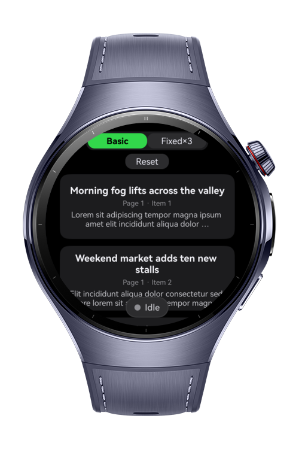
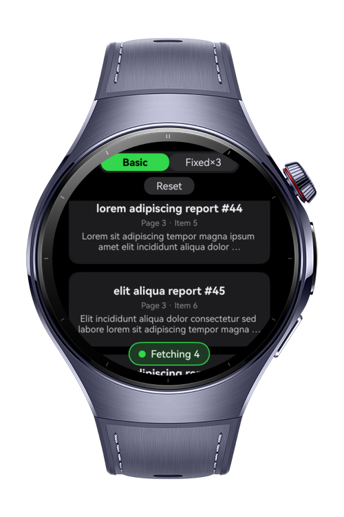

> **Note:** To access all shared projects, get information about environment setup, and view other guides, please visit [Explore-In-HMOS Index](https://github.com/Explore-In-HMOS/hmos-index).

# How To Build Data Prefetch Pipeline

**How To Build Data Prefetch Pipeline** (`how_to_build_data_prefetch_pipeline`) is a HarmonyOS wearable app that demonstrates the ArkUI data prefetching pipeline — using `IDataSourcePrefetching`, `IPrefetcher`, and the built-in `BasicPrefetcher` from `@kit.ArkUI` to load list content ahead of the scroll position for smooth scrolling on a bandwidth-constrained watch.

The app shows a single-page news feed backed by a `List` + `LazyForEach`. As the list scrolls, `List.onScrollIndex` reports the visible range to a prefetcher, which asks the data source to fetch upcoming article bodies before their cards appear on screen. A strategy toggle compares the adaptive `BasicPrefetcher` against a hand-written fixed-window prefetcher, a live status chip surfaces the pipeline state and in-flight fetch count, and a reset button reruns the demo in place.

# Preview

<div>
  
  
</div>

# Use Cases

- **Scroll-ahead prefetch**: Article bodies are fetched ahead of the visible range so cards are already loaded when they scroll into view.
- **Adaptive prefetching**: `BasicPrefetcher` adjusts how far ahead it prefetches based on scroll speed and fetch duration.
- **Obsolete fetch cancellation**: Fast scrolling cancels in-flight prefetches that are no longer needed via the data source's `cancel` hook.
- **Strategy comparison**: A toggle switches between the adaptive `BasicPrefetcher` and a manual fixed look-ahead prefetcher to compare automatic versus hand-tuned behavior.
- **Live pipeline status**: A pinned chip shows the IDLE/FETCHING state and the current in-flight fetch count in real time.
- **Pagination on scroll**: Reaching the end of the loaded window appends the next page of items to the lazy data source.
- **Reset in place**: A reset button clears loaded bodies and reruns the prefetch demo without leaving the page.

# Technology

## Stack

- **Languages**: ArkTS / ArkUI
- **Frameworks**: HarmonyOS SDK 6.0.1(21)
- **Tools**: DevEco Studio 6.x+
- **Libraries**:
  - `@kit.ArkUI`

## Required Permissions

No permission required. The feed is served by a pure local mock service with simulated latency, so the app makes no network requests.

# Directory Structure

```
entry/src/main/ets/
|---components
|   |---NewsCard.ets          // @Reusable card rendering a headline, body, and loading state
|   |---StatusChip.ets        // live IDLE/FETCHING chip with in-flight fetch count
|---data
|   |---NewsDataSource.ets    // implements IDataSourcePrefetching (prefetch / cancel / pagination)
|---model
|   |---NewsItem.ets          // @Observed news item model
|   |---PipelineState.ets     // @Observed pipeline status (state, in-flight, totals)
|---prefetch
|   |---FixedWindowPrefetcher.ets  // hand-written IPrefetcher with a fixed look-ahead window
|---service
|   |---MockNewsService.ets   // local mock news generator with simulated per-index latency
|---pages
|   |---Index.ets             // single page: strategy toggle, reset, status chip, list
|---entryability
|   |---EntryAbility.ets
```

# Constraints and Restrictions

The ArkUI Prefetcher APIs cannot run in the DevEco Studio Previewer per the official documentation. Behavioral verification of the prefetch pipeline requires a wearable emulator or a real device.

## Supported Devices

- Huawei Watch 5
- DevEco Studio wearable simulator

# License

**How To Build Data Prefetch Pipeline** is distributed under the terms of the MIT License.
See the [LICENSE](/LICENSE) for more information.
